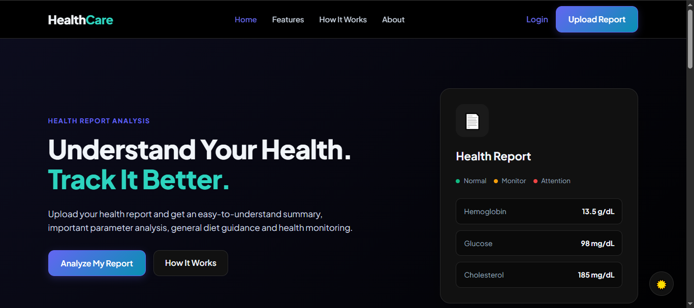
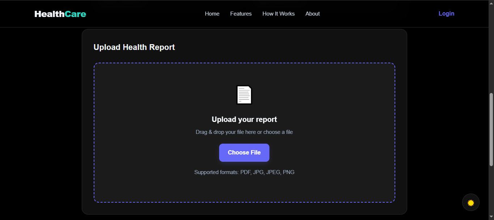
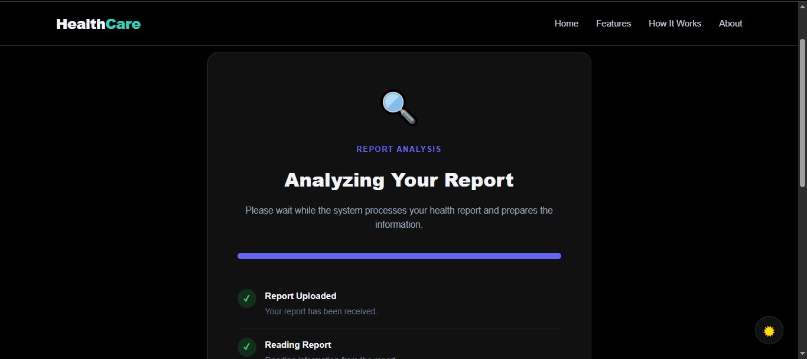
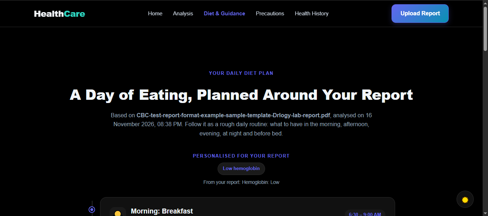
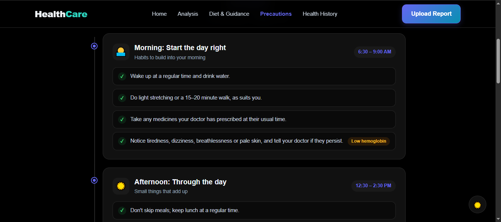
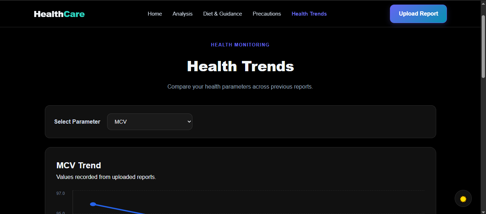

# 🏥 Health Report Analyzer

**Understand Your Health Reports. Track Your Progress.**

Health Report Analyzer is a web-based application built with Python and Flask that helps users understand health report information through report analysis, diet guidance, health precautions, and historical health trends.

## 📸 Project Preview

### Home Page


### Report Upload


### Report Analysis


### Diet & Guidance


### Health Precautions


### Health Trends


## ✨ Features

- **Report Upload:** Upload supported health report files.
- **Report Analysis:** Extract and display available health report information.
- **Diet Guidance:** View diet suggestions based on available analysis.
- **Health Precautions:** Display relevant health precautions.
- **Health History:** Review previously saved report information.
- **Health Trends:** Monitor changes in available health indicators over time.
- **User-Friendly Interface:** Simple and organized dashboard.

## 🛠️ Tech Stack

| Technology | Purpose |
|---|---|
| Python | Backend programming |
| Flask | Web framework |
| HTML5 | Page structure |
| CSS3 | Styling and layout |
| JavaScript | Frontend interactions |
| PyPDF | PDF text extraction |
| PyMuPDF | PDF processing |
| Tesseract OCR | Text recognition from images |
| Pillow | Image processing |

## 📂 Project Structure

```text
Health-Report-Analyzer/
│
├── app.py
├── daily_plan.py
├── requirements.txt
├── .gitignore
├── README.md
│
├── static/
│   ├── css/
│   │   └── style.css
│   └── js/
│       └── script.js
│
├── templates/
│   ├── index.html
│   ├── upload.html
│   ├── processing.html
│   ├── analysis.html
│   ├── diet.html
│   ├── precautions.html
│   ├── trends.html
│   └── _day_plan.html
│
└── Screenshots/
    ├── home.png
    ├── upload.png
    ├── analysis.png
    ├── diet.png
    ├── precaution.png
    └── treands.png
```

## ⚙️ Installation & Setup

### 1. Clone the Repository

```bash
git clone https://github.com/raosahab05/health-report-analyzer.git
```

### 2. Open the Project Folder

```bash
cd health-report-analyzer
```

### 3. Create a Virtual Environment

```bash
python -m venv venv
```

### 4. Activate Virtual Environment

**Windows:**

```powershell
venv\Scripts\activate
```

### 5. Install Dependencies

```bash
pip install -r requirements.txt
```

### 6. Run the Application

```bash
python app.py
```

Open your browser and visit:

```text
http://127.0.0.1:5000
```

## 🔮 Future Improvements

- Improved report interpretation.
- More detailed health trend visualizations.
- Enhanced report history management.
- Better user experience and dashboard features.

## ⚠️ Disclaimer

This project is developed for educational purposes. Its output is not a substitute for professional medical advice, diagnosis, or treatment. Always consult a qualified healthcare professional for medical decisions.

## 👨‍💻 Developer

**Yuvraj Yadav**

- GitHub: [@raosahab05](https://github.com/raosahab05)
- Project: [Health Report Analyzer](https://github.com/raosahab05/health-report-analyzer)

---

⭐ If you find this project interesting, consider giving it a star!